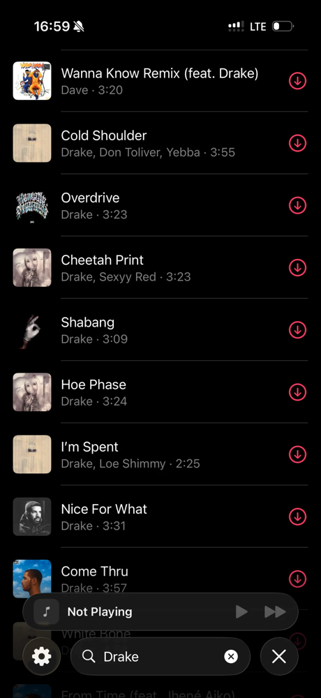
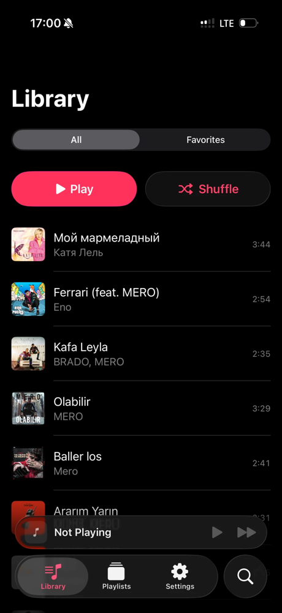
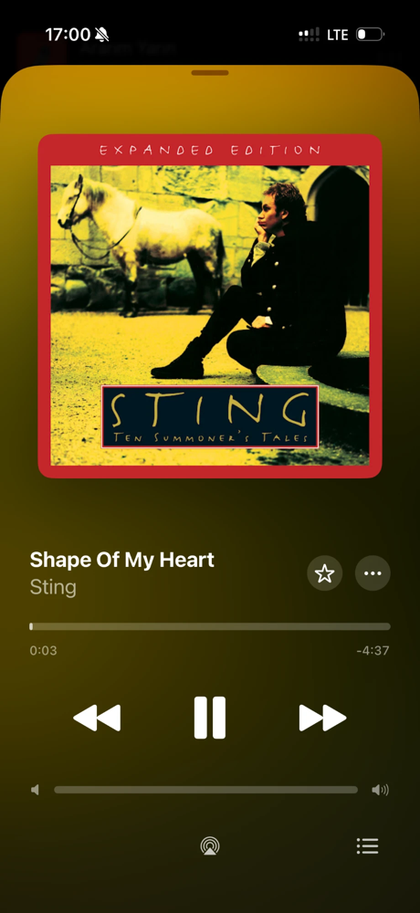
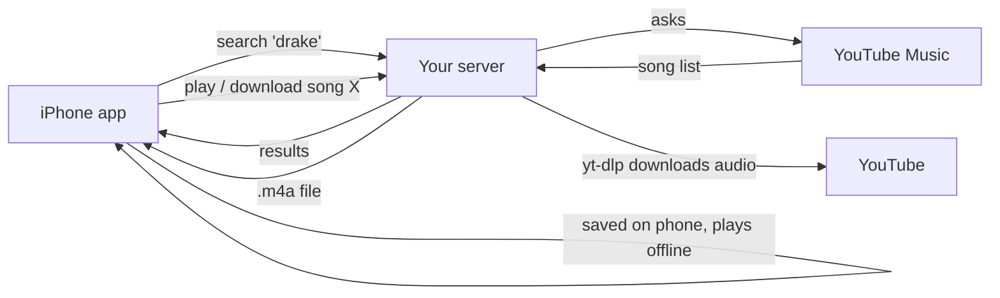

# Tunes

A personal music app for iPhone. Search any song, download it once, and listen offline — with playlists, favorites and an Apple Music–style player.

Songs come from YouTube. A small server that **you** run does the downloading, and the app keeps the files on your phone.

<p align="center">
  
  &nbsp;
  
  &nbsp;
  
</p>

> **For personal use only.** Downloading from YouTube is against YouTube's Terms of Service. Keep this to yourself and close friends, and never share your server or token publicly. This app is not for the App Store.

---

## Features

- **Search** songs and artists (results come from YouTube Music, with covers)
- **Stream** — tap a song to play it right away, no download needed
- **Download** with one tap — songs stay on your phone and play **offline**
- **Autoplay** — when your queue ends, similar songs keep playing (∞ button in the queue)
- **Library** with search, **Favorites** (star a song) and swipe to delete
- **Playlists** — create, rename, add songs, drag to reorder
- **Player** — colorful background from the cover, shuffle, repeat, "Playing Next" queue, volume bar, AirPlay
- Keeps playing in the **background** and on the **lock screen**
- Modern iOS 26 design (Liquid Glass tab bar, mini player)

---

## How it works



1. You type a song name in the app. The app asks **your server**.
2. The server searches **YouTube Music** and sends back the results (title, artist, cover).
3. You tap a song. The server gets the audio with **[yt-dlp](https://github.com/yt-dlp/yt-dlp)** and the app **streams** it (starts in a few seconds).
4. Tap **⬇︎** to keep a song: the app saves the file on your phone, and from now on it plays **without internet**.
5. When the queue ends, the app asks the server for **similar songs** (YouTube Music radio) and keeps playing.

The server only keeps songs for a short time (cache), so it needs very little disk space. Every request needs a secret **token**, so nobody else can use your server.

**Why a server?** YouTube has no free official download API, and an iPhone app can't run yt-dlp by itself. The server is a tiny Python program ([FastAPI](https://fastapi.tiangolo.com)) in a Docker container.

---

## What you need

| | |
|---|---|
| **A server** | Any small Linux server with Docker (Hetzner, DigitalOcean, etc. — the cheapest one is enough). Or your own computer, for testing. |
| **A domain or subdomain** *(recommended)* | So the app can use `https://`. Example: `music.yourdomain.com`. |
| **An iPhone** | iOS 26 or newer. |
| **A Mac** | With **Xcode** (free), to put the app on your iPhone. Xcode only runs on macOS — without a Mac you can't install the app this way. You can borrow a friend's Mac. |
| **An Apple ID** | A normal free Apple ID is enough. |

---

## Part 1 — Set up the server

First, make a secret token. It is like a password for your server. On Mac or Linux:

```bash
openssl rand -hex 32
```

Copy the long text it prints. You will need it twice: on the server and in the app.

### Option A: Coolify (easiest if you use Coolify)

1. In Coolify, open your project → **+ New Resource** → **Public Git Repository** → paste this repo's URL, branch `main`.
2. Open the new resource → **Configuration**:
   - **Build Pack / Build strategy:** `Dockerfile` *(not Railpack / Nixpacks)*
   - **Base Directory:** `/server`
   - **Dockerfile Location:** `/Dockerfile`
   - **Ports Exposes:** `8000`
3. **Domains:** `https://music.yourdomain.com` (point the domain's DNS to your server first).
4. **Environment Variables** → add `API_TOKEN` = your token. Do **not** tick "Build Variable".
5. **Health Check** → enable, path `/health`, port `8000`.
6. Press **Deploy**. When it says *Running*, open `https://music.yourdomain.com/health` in a browser. You should see `{"ok":true,...}`.

### Option B: Any server with Docker

This uses Docker Compose with [Caddy](https://caddyserver.com), which gets a free HTTPS certificate automatically.

1. Point your domain (e.g. `music.yourdomain.com`) to your server's IP address.
2. On the server:

   ```bash
   git clone https://github.com/karimyll/musicapp.git
   cd musicapp/server
   cp .env.example .env
   nano .env        # set API_TOKEN and DOMAIN
   docker compose up -d --build
   ```

3. Make sure ports **80** and **443** are open in your server's firewall.
4. Open `https://music.yourdomain.com/health` — you should see `{"ok":true,...}`.

**No domain?** Use a free one from [sslip.io](https://sslip.io): if your server IP is `65.21.10.20`, set `DOMAIN=65-21-10-20.sslip.io`.

### Option C: Your own computer (quick test only)

Good for trying it out. It only works while your computer is on and your phone is on the **same Wi-Fi**.

```bash
cd server
python3 -m venv .venv && .venv/bin/pip install -r requirements.txt
API_TOKEN=yourtoken CACHE_DIR=./cache .venv/bin/uvicorn app.main:app --host 0.0.0.0 --port 8000
```

In the app, use `http://YOUR-COMPUTER-IP:8000` (for example `http://192.168.0.12:8000`). Install [ffmpeg](https://ffmpeg.org) too (`brew install ffmpeg`), otherwise song lengths can show wrong. If your computer has a firewall, allow incoming connections for Python.

### Using Cloudflare?

Works fine. Make a DNS record for your subdomain (A → server IP, **Proxied**), and set SSL/TLS to **Full**. If **Bot Fight Mode** is on, Cloudflare may block the app — add a WAF *Skip* rule for your music subdomain.

### Why not Vercel (or other "serverless" hosts)?

It does not work well there:

- Vercel functions can only send back about **4.5 MB**. One song is usually 3–10 MB.
- There is no **ffmpeg**, and functions have **short time limits**.
- YouTube blocks these cloud IPs very often.

Use a normal small server (a VPS) instead. It costs a few dollars a month.

---

## Part 2 — If YouTube blocks your server ("not a bot")

YouTube sometimes blocks servers from data centers. You will see this error in the server logs or in the app:

> Sign in to confirm you're not a bot

The fix is to give the server **cookies** from a YouTube account, so YouTube treats it like a normal logged-in user.

1. Use a **spare Google account**, not your main one (YouTube may block it).
2. Install the browser extension **"Get cookies.txt LOCALLY"** (Chrome / Firefox) and allow it in private / incognito windows.
3. Open a **private (incognito) window** → go to youtube.com → log in with the spare account.
4. In the **same tab**, open `https://www.youtube.com/robots.txt`.
5. Click the extension → **Export** (Netscape format). You get a `cookies.txt` file.
6. **Close the private window** right away. (If you keep using it, YouTube changes the cookies and the file stops working.)
7. Give the file to the server:
   - **Coolify:** resource → **Persistent Storage** → **+ Add** → **File Mount** → path `/data/cookies/cookies.txt` → paste the file's content → Save → **Restart**.
   - **Docker Compose:** put the file at `server/cookies/cookies.txt` → `docker compose restart api`.
8. Check the server logs. You should see: `cookies: loaded from /data/cookies/cookies.txt`.

Cookies can expire after a few weeks. If the error comes back, repeat these steps.

---

## Part 3 — Put the app on your iPhone

The app is not on the App Store, so you install it yourself with **Xcode** on a **Mac**. It's free.

With a free Apple ID, the installed app works for **7 days**. After that, connect the phone and press Run again (step 7). Your songs and playlists are **not** deleted when you do this.

> **No Mac?** Xcode only works on macOS, so you need a Mac for this — yours or a friend's. You only need it for a few minutes: once to install, and once a week to refresh.

1. Install **Xcode** from the Mac App Store, and XcodeGen (needs [Homebrew](https://brew.sh)):

   ```bash
   brew install xcodegen
   ```

2. Open `ios/project.yml` and change two lines:
   - `PRODUCT_BUNDLE_IDENTIFIER:` → something unique, e.g. `com.yourname.tunes`
   - `DEVELOPMENT_TEAM:` → delete this line (you will pick your team in Xcode)
3. Create the Xcode project and open it:

   ```bash
   cd ios && xcodegen generate && open MusicApp.xcodeproj
   ```

4. Xcode → **Settings → Accounts** → add your Apple ID.
5. Click **MusicApp** (blue icon on the left) → **Signing & Capabilities** → **Team:** choose *Your Name (Personal Team)*.
6. Connect your iPhone with a cable. On the iPhone, turn on **Developer Mode** (Settings → Privacy & Security → Developer Mode) and restart.
7. Pick your iPhone at the top of Xcode and press **▶︎ Run**.
8. The first time, on the iPhone: **Settings → General → VPN & Device Management** → tap your Apple ID → **Trust**.

**After 7 days** the app won't open. Connect the phone and press **▶︎ Run** in Xcode again.

---

## Part 4 — Connect the app to your server

1. Open **Tunes** → **Settings** tab.
2. **Server URL:** `https://music.yourdomain.com`
3. **API token:** the same token you put on the server.
4. Tap **Test Connection**. You should see **✅ Connected**.
5. Go to **Search** (magnifier, bottom right) and find a song.
   - **Tap the song** to listen right away (streaming).
   - **Tap ⬇︎** to download it. When it turns into a green ✓, the song is on your phone and works offline.

---

## Sharing with friends

- Every friend installs the app with Xcode (Part 3). Friends without a Mac can plug their iPhone into your Mac — sign in with **their own** Apple ID in Xcode.
- They can use **your server**: give them the Server URL and the token **privately** (not in a group chat).
- Everyone uses the same token. If it leaks, make a new one, update `API_TOKEN` on the server, and send the new token to your friends.
- More people means more downloads from one YouTube account (cookies). For a few friends this is fine.

---

## Keeping it running

| What | How |
|---|---|
| **Downloads suddenly fail** | Restart the server. It updates yt-dlp on every start, which fixes most YouTube changes. |
| **"not a bot" error again** | Export new cookies (Part 2). |
| **Update the server code** | Push to GitHub → Coolify **Redeploy** (or `git pull && docker compose up -d --build`). |
| **App stopped opening** | 7 days passed. Connect the phone to the Mac and press **▶︎ Run** in Xcode again. |

---

## Troubleshooting

| You see | What it means / what to do |
|---|---|
| **Wrong token (401)** | The token in the app is not the same as `API_TOKEN` on the server. |
| **YouTube blocked the server (bot check)** | Add cookies — see Part 2. |
| **Server error (502 / 503)** | The server is down or restarting. Check the server logs. In Coolify, make sure Build Pack is **Dockerfile** and Port is **8000**. |
| **Connection lost / timed out** | Wrong Server URL, firewall blocks ports 80/443, or (Option C) phone and computer are not on the same Wi-Fi. |
| **Song length looks wrong** | The server has no ffmpeg (only happens in Option C). Install ffmpeg. |
| **"This video is unavailable."** | That video is private or blocked. Choose another result. |

---

## Server settings

| Variable | Default | What it does |
|---|---|---|
| `API_TOKEN` | — *(required)* | Secret token. The app must send it. |
| `DOMAIN` | — | Only for Option B (Caddy): your domain. |
| `CACHE_MAX_GB` | `2` | Max disk space for cached songs on the server. |
| `CACHE_TTL_HOURS` | `24` | Cached songs are deleted after this many hours. |
| `COOKIES_FILE` | `/data/cookies/cookies.txt` | Where the server looks for YouTube cookies. |

Server endpoints (all except `/health` need the header `Authorization: Bearer <token>`):

- `GET /health` — is the server alive?
- `GET /search?q=<text>` — search songs
- `GET /audio/<videoId>` — get the song as `.m4a` (used for streaming and downloading)
- `GET /radio/<videoId>` — similar songs (Autoplay)
- `GET /search?q=<text>&type=albums`, `GET /album/<id>`, `GET /playlist?url=<link>` — albums and playlist links (server side is ready; not in the app yet)

---

## Project structure

```
server/                 The server (Python, FastAPI, yt-dlp)
  app/main.py           All server code
  Dockerfile            Used by Coolify / Docker
  docker-compose.yml    Option B (with Caddy for HTTPS)
ios/                    The iPhone app (SwiftUI)
  project.yml           Project settings (XcodeGen makes the Xcode project from it)
  MusicApp/             App source code
docs/screenshots/       Pictures used in this README
```
